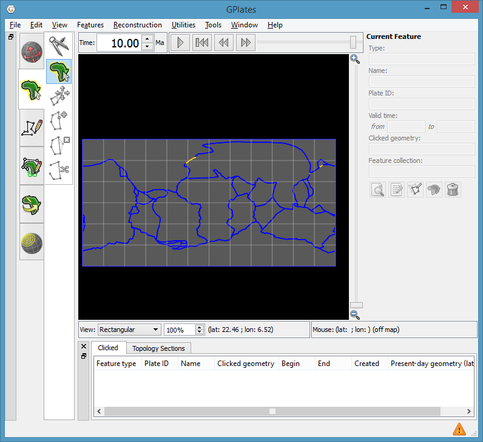

.. _pygplates_detect_topology_gaps_and_overlaps:

Find gaps and overlaps in global topological boundaries
^^^^^^^^^^^^^^^^^^^^^^^^^^^^^^^^^^^^^^^^^^^^^^^^^^^^^^^

This example resolves topological plate polygons (and deforming networks) over a series of
geological times, and detects any gaps and overlaps in their coverage of the globe.

The sub-segments beside a gap or an overlap are written to a file for each time. The files can be
loaded into `GPlates <http://www.gplates.org>`_, to see where the gaps and overlaps are alongside
the dynamic plate polygons.

There is a gap or an overlap where:

- an area of the globe is not covered by a topological boundary or network, or
- two (or more) topological boundary polygons overlap in an area of the globe.

A gap is also reported where a boundary is made of two *identical* boundary sections, one used by
each of the neighbouring topological boundaries. There should be only one section, shared by both.

A deforming network that lies over a topological boundary polygon is not an overlap. Networks
usually do overlay the rigid plates.

.. contents::
   :local:
   :depth: 2

Data files
""""""""""

``topologies.gpml``
    Topological plate polygon features, intended to cover the globe. There can also be deforming
    network features, which can overlay the plate polygons.

``rotations.rot``
    A rotation file. It must contain rotations for the plate IDs of the topological features.

Files of these kinds are in the GPlates `sample data <https://www.gplates.org/download/>`_.

Sample code
"""""""""""

.. sample-code:: pygplates_detect_topology_gaps_and_overlaps.py

Details
"""""""

A :class:`topological model<pygplates.TopologicalModel>` is created from the topological features
and the rotation file. The topological features can be plate polygons, deforming networks or both.

Here there is one file of topological features and one rotation file. More than one of each can be
given, and a :class:`pygplates.RotationModel` can be given in place of the rotation files.

.. sample-code:: pygplates_detect_topology_gaps_and_overlaps.py
   :fragment: create-topological-model

.. note:: The :class:`pygplates.TopologicalModel` is created **outside** the time loop, since it does not depend on ``time``.

:meth:`pygplates.TopologicalModel.topological_snapshot` resolves the topological features at the
current ``time``, and returns the result as a :class:`pygplates.TopologicalSnapshot`.

.. sample-code:: pygplates_detect_topology_gaps_and_overlaps.py
   :fragment: topological-snapshot

:meth:`pygplates.TopologicalSnapshot.get_resolved_topological_sections` returns the boundary
sections of the resolved topologies in the snapshot. By default these are the sections on the
boundaries of both the resolved plate polygons (:class:`pygplates.ResolvedTopologicalBoundary`) and
the resolved deforming networks (:class:`pygplates.ResolvedTopologicalNetwork`).

.. sample-code:: pygplates_detect_topology_gaps_and_overlaps.py
   :fragment: resolved-topological-sections

These :class:`boundary sections<pygplates.ResolvedTopologicalSection>` are used because each of
their sub-segments has a list of the topologies that share it.

Not all of the geometry of a boundary section feature is on the boundary of a topology. For
example, the ends of a section that extend past its neighbouring sections are clipped off.
:meth:`pygplates.ResolvedTopologicalSection.get_shared_sub_segments` returns the parts that are on
a boundary.

.. sample-code:: pygplates_detect_topology_gaps_and_overlaps.py
   :fragment: shared-sub-segments

:meth:`pygplates.ResolvedTopologicalSharedSubSegment.get_sharing_resolved_topologies` returns the
list of topologies that share a :class:`sub-segment<pygplates.ResolvedTopologicalSharedSubSegment>`.

:meth:`pygplates.ResolvedTopologicalSharedSubSegment.get_sharing_resolved_topology_on_left_flags`
returns a list in the same order, with ``True`` for each topology that is on the left side of the
sub-segment and ``False`` for each one on the right. The left side is the one on the left when
following the points of the sub-segment from its first to its last.

.. sample-code:: pygplates_detect_topology_gaps_and_overlaps.py
   :fragment: sharing-resolved-topologies

If the resolved topologies cover the globe with no gaps or overlaps, then each side of a
sub-segment has one resolved boundary (a plate) on it, or one resolved network, or one of each.

So it is not enough to count the topologies that share a sub-segment:

- A subduction zone whose overriding plate has a deforming network lying over it is shared by
  three topologies (two plates and the network), with nothing wrong.
- Two topologies sharing a sub-segment could both be on the same side of it, which is an overlap
  on that side and a gap on the other.

Instead the script counts the plates and the networks separately, on each side.

.. sample-code:: pygplates_detect_topology_gaps_and_overlaps.py
   :fragment: count-each-side

There is an overlap if either side of the sub-segment has more than one plate, or more than one network.

.. sample-code:: pygplates_detect_topology_gaps_and_overlaps.py
   :fragment: overlap

There is a gap if a side of the sub-segment has neither a plate nor a network on it.

For a sub-segment that a plate shares, the lists answer that. Plates (and the networks between them)
cover the globe, so a side with nothing on it is a gap.

A sub-segment shared only by networks is different, because models use deforming networks in two
ways:

- In most recent models, networks *overlay* plates. The parts of a network's boundary that cross a
  plate's interior have the network on one side only, with the plate lying beneath on both sides.
  But the plate doesn't share those sub-segments (they aren't part of its boundary), so it isn't in
  the lists, and the other side looks empty when it isn't.
- In older models, networks *abut* plates (and each other, such as two rift networks along a rift
  axis), and no plate lies beneath them. There a side with nothing on it is a gap.

The lists (which hold only the topologies that share a sub-segment) can't tell the two apart. So for
a side of such a sub-segment with nothing on it, the script tests a point just off that side, and
reports a gap only if no plate or network contains it.
:meth:`pygplates.TopologicalSnapshot.calculate_plate_boundary_statistics` does the same, when it
finds nothing sharing a side of a sub-segment.

.. sample-code:: pygplates_detect_topology_gaps_and_overlaps.py
   :fragment: gap

The test point is in the middle of the sub-segment's longest arc, moved off it along the arc's
great circle normal, which points to the left of the arc.

How far matters. A point-in-polygon test counts a point within about 9 metres (1.4e-6 radians) of
a polygon's outline as being on it, and so inside. So a test point closer than that to a network's
edge would be found inside the network itself, and a gap beside a network would never be found.
The script uses 10 times that distance (about 90 metres), as the plate boundary statistics do.
Don't make it smaller.

:meth:`pygplates.TopologicalSnapshot.get_point_locations` searches every resolved plate and
network, whether or not it shares the sub-segment.

.. sample-code:: pygplates_detect_topology_gaps_and_overlaps.py
   :fragment: is-side-covered

If a gap or an overlap was found, the script records the sub-segment's feature, with a description
saying which was found (it can be both).

.. sample-code:: pygplates_detect_topology_gaps_and_overlaps.py
   :fragment: record-anomalous-feature

Finally, if any anomalous features were found at the current ``time``, they are written to a file
with that time in its name.

.. sample-code:: pygplates_detect_topology_gaps_and_overlaps.py
   :fragment: write-anomalous-features

Visualising gaps and overlaps in GPlates
""""""""""""""""""""""""""""""""""""""""

The output files, such as ``anomalous_sub_segments_at_10Ma.gpml``, can be loaded into
`GPlates <http://www.gplates.org>`_ to see where the topological errors are on the globe.

   GPlates screenshot showing anomalous sub-segments (yellow) and dynamic plate polygons (blue) at 10Ma.

The following two screenshots show a zoomed-in view of a gap and an overlap.

.. figure:: ../images/anomalous_sub_segments_gap.png

   GPlates screenshot showing zoomed-in view of a **gap** in dynamic polygon coverage (outlined in yellow) at 10Ma.

.. figure:: ../images/anomalous_sub_segments_overlap.png

   GPlates screenshot showing zoomed-in view of an **overlap** in dynamic polygon coverage (outlined in yellow) at 10Ma.

See also
""""""""

- Primer: :ref:`pygplates_primer_topological_snapshot`
- Reference: :class:`pygplates.TopologicalModel`, :meth:`pygplates.TopologicalSnapshot.get_resolved_topological_sections`,
  :meth:`pygplates.ResolvedTopologicalSection.get_shared_sub_segments`,
  :meth:`pygplates.ResolvedTopologicalSharedSubSegment.get_sharing_resolved_topologies`,
  :meth:`pygplates.ResolvedTopologicalSharedSubSegment.get_sharing_resolved_topology_on_left_flags`
- Sample code: :ref:`pygplates_find_total_ridge_and_subduction_zone_lengths`,
  :ref:`pygplates_find_overriding_plate_of_closest_subducting_line`
