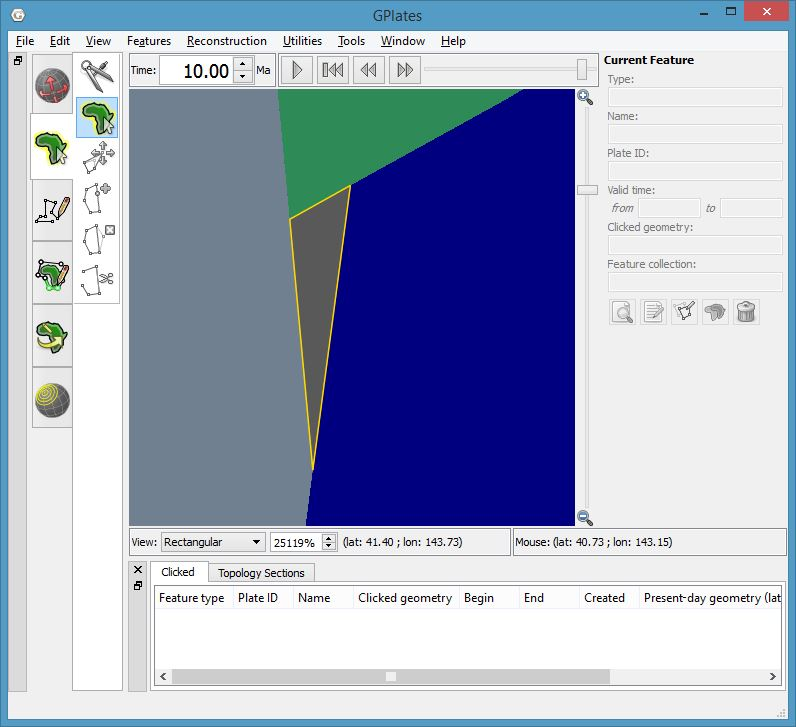
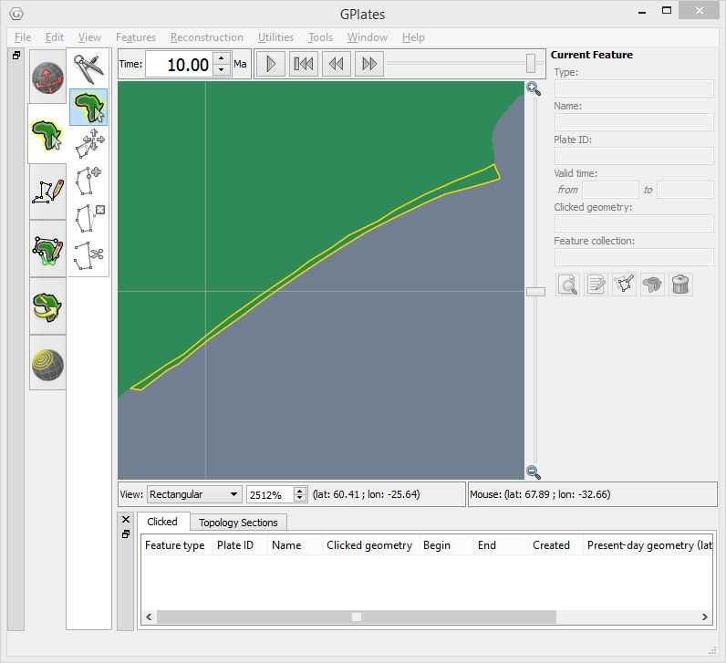

.. _pygplates_detect_topology_gaps_and_overlaps:

Find gaps and overlaps in global topological boundaries
^^^^^^^^^^^^^^^^^^^^^^^^^^^^^^^^^^^^^^^^^^^^^^^^^^^^^^^

| This example resolves topological plate polygons (and deforming networks) and detects any gaps and
  overlaps in their global coverage.
| Anomalous sub-segments, locating the gaps/overlaps, are written to a file that can be loaded into
  `GPlates <http://www.gplates.org>`_ to visualise alongside the dynamic plate polygons.

Gaps and overlaps are caused when:

- there is an area of the globe not covered by a topological boundary or network, or
- two (or more) topological boundary polygons overlap in some area of the globe.

This can also happen if two topological line sections are *identical* when ideally there should
only be one of them (and it should be shared by two neighbouring topological boundaries).

A deforming network that lies over a topological boundary polygon is not an overlap. Networks
usually do overlay the rigid plates.

.. contents::
   :local:
   :depth: 2

Data files
""""""""""

``topologies.gpml``
    Topological plate polygon features, intended to cover the globe. There can also be deforming
    network features, which can overlay the plate polygons.

``rotations.rot``
    A rotation file. It must contain rotations for the plate IDs of the topological features.

Files of these kinds are in the GPlates `sample data <https://www.gplates.org/download/>`_.

Sample code
"""""""""""

.. sample-code:: pygplates_detect_topology_gaps_and_overlaps.py

Details
"""""""

| First create a :class:`topological model<pygplates.TopologicalModel>` from topological features and rotation files.
| The topological features can be plate polygons and/or deforming networks.
| More than one file containing topological features can be specified here, however we're only specifying one file.
| Also note that more than one rotation file (or even a single :class:`pygplates.RotationModel`) can be specified here,
  however we're only specifying a single rotation file.

.. sample-code:: pygplates_detect_topology_gaps_and_overlaps.py
   :fragment: create-topological-model

.. note:: We create our :class:`pygplates.TopologicalModel` **outside** the time loop since that does not require ``time``.

| Get a snapshot of our resolved topologies.
| Here the topological features are resolved to the current ``time``
  using :func:`pygplates.TopologicalModel.topological_snapshot`.

.. sample-code:: pygplates_detect_topology_gaps_and_overlaps.py
   :fragment: topological-snapshot

| Extract the boundary sections between our resolved topological plate polygons (and deforming networks) from the current snapshot.
| By default both :class:`pygplates.ResolvedTopologicalBoundary` (used for dynamic plate polygons) and
  :class:`pygplates.ResolvedTopologicalNetwork` (used for deforming regions) are listed in the boundary sections.

.. sample-code:: pygplates_detect_topology_gaps_and_overlaps.py
   :fragment: resolved-topological-sections

These :class:`boundary sections<pygplates.ResolvedTopologicalSection>` are actually what
we're interested in because their sub-segments have a list of topologies on them.

| Not all parts of a topological section feature's geometry contribute to the boundaries of topologies.
| Little bits at the ends get clipped off.
| The parts that do contribute can be found using :meth:`pygplates.ResolvedTopologicalSection.get_shared_sub_segments`.

.. sample-code:: pygplates_detect_topology_gaps_and_overlaps.py
   :fragment: shared-sub-segments

| The list of topologies that share a :class:`sub-segment<pygplates.ResolvedTopologicalSharedSubSegment>`
  is obtained using :meth:`pygplates.ResolvedTopologicalSharedSubSegment.get_sharing_resolved_topologies`.
| :meth:`pygplates.ResolvedTopologicalSharedSubSegment.get_sharing_resolved_topology_on_left_flags`
  returns a list in the same order, with ``True`` for each topology that is on the left side of the
  sub-segment and ``False`` for each one on the right. The left side is the one on the left when
  following the points of the sub-segment from its first to its last.

.. sample-code:: pygplates_detect_topology_gaps_and_overlaps.py
   :fragment: sharing-resolved-topologies

| If the resolved topologies have global coverage with no gaps/overlaps then each side of a
  sub-segment has one resolved boundary (a plate) on it, or one resolved network, or one of each.
| So it is not enough to count the topologies that share a sub-segment. A subduction zone whose
  overriding plate has a deforming network lying over it is shared by three topologies (two plates and
  the network), with nothing wrong. And two topologies sharing a sub-segment could both be on the same
  side of it, which is an overlap on that side and a gap on the other.
| Instead we count the plates and the networks separately, on each side.

.. sample-code:: pygplates_detect_topology_gaps_and_overlaps.py
   :fragment: count-each-side

There is an overlap if either side of the sub-segment has more than one plate, or more than one network.

.. sample-code:: pygplates_detect_topology_gaps_and_overlaps.py
   :fragment: overlap

| There is a gap if either side of the sub-segment has neither a plate nor a network.
| We only test this for a sub-segment that at least one plate shares. A sub-segment shared only by
  networks is not tested for a gap, because the lists cannot tell us whether it has one beside it. Where a
  network overlays a plate, the parts of the network's boundary that cross the plate's interior have
  the network on one side only, with the plate lying beneath on both sides. But the plate does not
  share those sub-segments (they are not part of its boundary), so it is not in the lists.
  (:meth:`pygplates.TopologicalSnapshot.calculate_plate_boundary_statistics` also leaves out such
  sub-segments by default, since they are not necessarily plate boundaries.)
| This means a gap beside a network is only found where the network's boundary is also the boundary of a plate.

.. sample-code:: pygplates_detect_topology_gaps_and_overlaps.py
   :fragment: gap

If we found a gap or an overlap then we record the sub-segment's feature, with a description
saying which was found (it can be both).

.. sample-code:: pygplates_detect_topology_gaps_and_overlaps.py
   :fragment: record-anomalous-feature

Finally we write the anomalous features to a file.

.. sample-code:: pygplates_detect_topology_gaps_and_overlaps.py
   :fragment: write-anomalous-features

Visualising gaps and overlaps in GPlates
""""""""""""""""""""""""""""""""""""""""

The resulting output files such as ``anomalous_sub_segments_at_10Ma.gpml`` can be loaded into
`GPlates <http://www.gplates.org>`_ to see where the topological errors are located on the globe.

.. figure:: ../images/anomalous_sub_segments.png

   GPlates screenshot showing anomalous sub-segments (yellow) and dynamic plate polygons (blue) at 10Ma.

The following two screenshots show a zoomed-in view of a gap and an overlap.

   GPlates screenshot showing zoomed-in view of a **gap** in dynamic polygon coverage (outlined in yellow) at 10Ma.

   GPlates screenshot showing zoomed-in view of an **overlap** in dynamic polygon coverage (outlined in yellow) at 10Ma.

See also
""""""""

- Primer: :ref:`pygplates_primer_topological_snapshot`
- Reference: :class:`pygplates.TopologicalModel`, :meth:`pygplates.TopologicalSnapshot.get_resolved_topological_sections`,
  :meth:`pygplates.ResolvedTopologicalSection.get_shared_sub_segments`,
  :meth:`pygplates.ResolvedTopologicalSharedSubSegment.get_sharing_resolved_topologies`,
  :meth:`pygplates.ResolvedTopologicalSharedSubSegment.get_sharing_resolved_topology_on_left_flags`
- Sample code: :ref:`pygplates_find_total_ridge_and_subduction_zone_lengths`,
  :ref:`pygplates_find_overriding_plate_of_closest_subducting_line`
